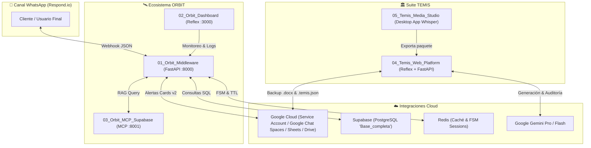
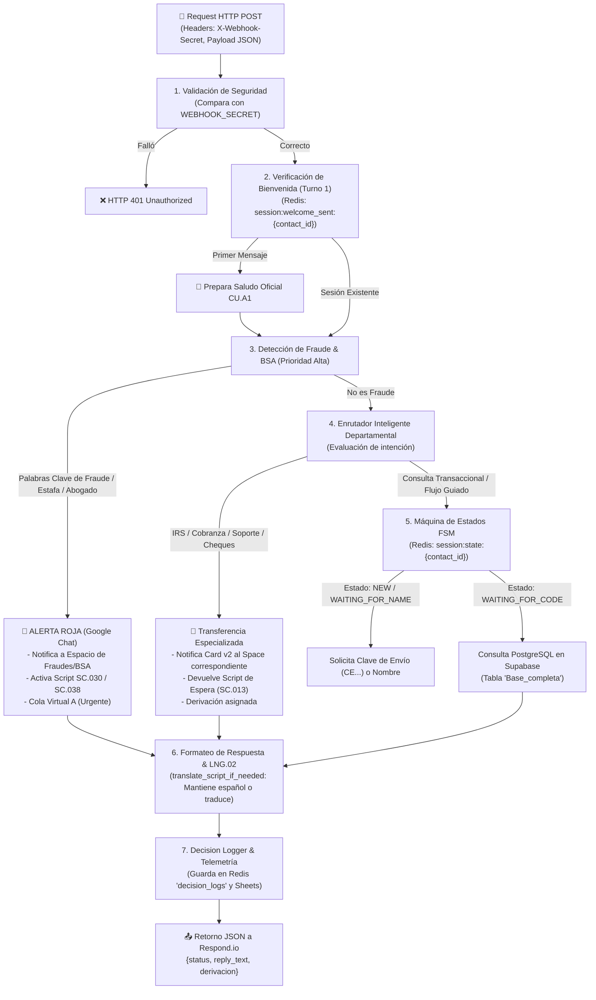
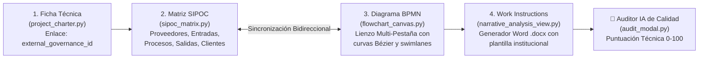

# 🛰️ Manual Canónico de Arquitectura y Guía de Desarrollo: ORBIT & TEMIS
**Destinatarios:** Equipo de Desarrollo / Nuevos Desarrolladores  
**Entorno de Trabajo:** Antigravity IDE | Monorepo de Innovación  
**Versión del Ecosistema:** Orbit v4.7 & Temis v2.0 Decoupled  
**Fecha:** Octubre 2026  

---

## 🧭 1. Visión General del Ecosistema

El ecosistema tecnológico transferido se compone de dos grandes plataformas modulares que operan en producción:

1. **ORBIT (Middleware Conversacional & Orquestación de Agentes):**
   * **Propósito:** Cerebro transaccional y enrutador inteligente para los canales de atención al cliente (WhatsApp vía Respond.io). 
   * **Misión:** Validar intenciones, consultar estados de remesas/recargas/servicios, prevenir fraudes/AML, disparar alertas interdepartamentales a Google Chat y gestionar la persistencia y caché en tiempo real con Redis y Supabase.
   
2. **TEMIS (Motor de Documentación y Arquitectura de Procesos):**
   * **Propósito:** Suite de ingeniería de procesos para diseñar diagramas BPMN, matrices SIPOC, generar manuales de políticas y procedimientos en Word corporativo (`.docx`), y auditar la calidad técnica mediante Inteligencia Artificial (Google Gemini).



---

# 🛰️ PARTE 1: ARQUITECTURA DETALLADA DE ORBIT (Enfoque Principal)

Orbit está dividido en 3 carpetas autónomas dentro del paquete:
* 📁 `01_Orbit_Middleware/`: El API Core en FastAPI (el motor principal).
* 📁 `02_Orbit_Dashboard/`: Panel web interactivo hecho en Reflex para supervisión, colas y auditoría.
* 📁 `03_Orbit_MCP_Supabase/`: Microservicio MCP (Model Context Protocol) para consultas inteligentes a Supabase y RAG.

---

## 🔄 1.1 Ciclo de Vida de una Petición en Orbit

Cuando un usuario escribe por WhatsApp a través de **Respond.io**, se envía una petición `POST` al endpoint principal `/api/v1/agent/interact` (o `/webhook`). Este es el camino exacto que sigue el código:



---

## 🗺️ 1.2 Mapa de Lectura de Código: Archivo por Archivo

Para que los desarrolladores nuevos sepan exactamente qué hace cada archivo en `01_Orbit_Middleware/api/`:

| Archivo | Rol en el Sistema | Símbolos y Funciones Clave |
| :--- | :--- | :--- |
| **`api/main.py`** | **El Corazón de Orbit.** Contiene todos los endpoints FastAPI, lógica FSM, detección de intención y consultas directas a base de datos. | • `@app.post("/api/v1/agent/interact")`: Entrada principal de Respond.io.<br>• `agent_interact_inner()`: Orquestador central.<br>• `check_transaction_status_inner()`: Búsqueda de remesas en Supabase.<br>• `check_bill_status_inner()`: Búsqueda de pago de facturas.<br>• `check_topup_status_inner()`: Búsqueda de recargas.<br>• `match_keyword_safe()`: Comparador seguro de palabras completas regex. |
| **`api/config.py`** | **Configuración y Parámetros.** Define la clase `Settings` (Pydantic BaseSettings). | • `WEBHOOK_SECRET`: Token de autenticación de webhooks.<br>• `GOOGLE_SHEET_ID_SCRIPTS`: Hoja de scripts oficiales (`18VE...`).<br>• `GOOGLE_SHEET_ID_REGLAS`: Hoja de reglas de negocio (`1eFm...`).<br>• `GOOGLE_CHATS_*_SPACE`: Lista de Space IDs de Google Chat por departamento. |
| **`api/shared_logic.py`** | **Lógica Compartida & Utilidades.** | • `get_db_connection()`: Pool de conexiones a Supabase con `psycopg2`.<br>• `get_compliance_scripts()`: Descarga y parseo de scripts oficiales.<br>• `translate_script_if_needed()`: **Regla LNG.02** (Restablecimiento dinámico de idioma). Si el usuario escribe en español, no fuerza inglés. |
| **`api/google_chat_service.py`** | **Notificaciones a Google Chat.** Maneja la autenticación JWT con Service Account. | • `send_alert_detailed()`: Genera tarjetas visuales (Cards v2) con botones, tags de prioridad y datos del contacto hacia los Spaces de Google Chat. |
| **`api/decision_logger.py`** | **Auditoría de Decisiones y Colas Virtuales.** | • `save_decision_log()`: Registra cada decisión del bot en Redis para que aparezca en tiempo real en el Dashboard Reflex (`/decision-logs`). Clasifica en **Cola A** (Fraudes/Riesgo) o **Cola B** (Operaciones normales). |
| **`api/mcp_client.py`** | **Cliente MCP & Circuit Breaker.** | • `call_mcp()`: Ejecuta llamadas HTTP hacia servidores MCP con política de reintentos y Circuit Breaker para no congelar la API si el MCP falla. |
| **`api/admin_api.py`** | **Endpoints de Administración & Métricas.** | • Rutas auxiliares para forzar sincronización de scripts, probar webhooks y consultar el estado del Circuit Breaker. |
| **`shared/redis_client.py`** | **Conexión Asíncrona a Redis.** | • `get_redis_client()`: Retorna cliente singleton `redis.asyncio` para manejo de sesiones no bloqueantes. |

---

## 🛠️ 1.3 Recetario de Desarrollo para Orbit: ¿Dónde moverle o agregar?

### 🎯 Caso 1: Agregar un Nuevo Departamento o Cambiar el Canal de Google Chat
1. **Configurar el Space ID:** En `api/config.py`, agrega la variable con el ID del espacio:
   ```python
   GOOGLE_CHATS_NUEVO_DEPTO_SPACE: str = "spaces/AAAAxxxxxx"
   ```
2. **Agregar la regla de detección:** En `api/main.py`, busca el bloque `# ENRUTADOR INTELIGENTE DE DEPARTAMENTOS` (alrededor de la línea ~3800-4200) y añade:
   ```python
   # Detectar intención de Nuevo Depto
   nuevo_depto_kws = ["tarjetas", "devolucion de cargo", "aclaracion de saldo"]
   if any(match_keyword_safe(kw, user_text_lower) for kw in nuevo_depto_kws):
       mensaje_alerta = (
           f"💳 *SOLICITUD DE ACLARACIONES*\n\n"
           f"👤 *Contacto:* {contact_id}\n"
           f"💬 *Mensaje:* {user_text}\n"
           f"🕒 *Hora:* {datetime.now().strftime('%H:%M:%S')}"
       )
       # Disparar tarjeta a Google Chat
       await google_chat_service.send_alert_detailed(
           title="Atención Requerida: Aclaraciones",
           message=mensaje_alerta,
           level="INFO",
           space_id=settings.GOOGLE_CHATS_NUEVO_DEPTO_SPACE
       )
       # Responder al usuario con script oficial de espera
       texto_espera = scripts.get("SC.013", "En breve un asesor de aclaraciones le atenderá.")
       respuesta_final = await translate_script_if_needed(texto_espera, user_text, contact_id=contact_id)
       return AgentInteractResponse(status="success", reply_text=respuesta_final, derivacion="Aclaraciones")
   ```

### 🎯 Caso 2: Modificar o Agregar Palabras Clave de Transferencia a Humano
* **Ubicación:** `api/main.py` ➔ Bloque `# Asesor humano explícito`.
* **Regla de Oro:** Usa siempre `match_keyword_safe(keyword, user_text)` o regex con límites de palabra (`\bpalabra\b`). Nunca uses un simple `if "agente" in texto` porque palabras como `"urgente"` o `"inteligente"` activarían una transferencia accidental.

### 🎯 Caso 3: Actualizar Textos de Scripts Oficiales (`SC.001` - `SC.036`)
* Los textos oficiales de los scripts residen en la hoja de **Google Sheets (ID en `settings.GOOGLE_SHEET_ID_SCRIPTS`)**.
* El Middleware los guarda en caché de Redis (`scripts_cache`) por 1 hora.
* **Para forzar la actualización inmediata sin reiniciar:**
  - Envía una petición `POST` al endpoint `/api/v1/scripts/sync` (o usa el botón de sincronización en el Dashboard Reflex).

### 🎯 Caso 4: Modificar Consultas a la Base de Datos (Supabase)
* **Ubicación:** `api/main.py` ➔ Funciones `check_transaction_status_inner()` o `buscar_por_telefono()`.
* **Tabla Principal:** `"Base_completa"`.
* **Campos Críticos:**
  - `"Clave_Envio"`: Código alfanumérico único de remesa (ej. `CE12345678`).
  - `"Telefono_Remitente"` y `"Telefono_Beneficiario"`.
  - `"status"`: Estado (`PAGADO`, `DISPONIBLE`, `CANCELADO`, `EN REVISION`).
  - `"Nombre_Remitente"` y `"Nombre_Beneficiario"`.

---

## 🗄️ 1.4 Esquema de Llaves de Redis (Memory Map)

Orbit usa Redis intensivamente para no sobrecargar la base de datos y mantener el estado conversacional:

| Llave en Redis | TTL | ¿Qué almacena? |
| :--- | :--- | :--- |
| `session:welcome_sent:{contact_id}` | 1 hora | `1` si el saludo inicial `CU.A1` ya fue entregado en la sesión. Evita re-saludar en cada mensaje. |
| `session:state:{contact_id}` | 1 hora | Estado actual FSM: `NEW`, `WAITING_FOR_NAME`, `WAITING_FOR_CODE`, `COMPLETED`. |
| `session:codigo_envio:{contact_id}` | 1 hora | Clave de envío temporal detectada en la conversación. |
| `session:fraud_collecting:{contact_id}`| 1 hora | Bandera de recolección de reporte de fraude en curso. |
| `scripts_cache` | 1 hora | JSON completo con los scripts oficiales descargados del Google Sheet. |
| `decision_logs` (List) | Persistente | Lista FIFO con los últimos 1,000 eventos de decisión para el Dashboard Reflex. |

---

## 📊 1.5 El Dashboard de Monitoreo: `02_Orbit_Dashboard`

Construido íntegramente en **Reflex** (Python puro compilado a React/Next.js):
* **Punto de Entrada:** `dashboard_reflex/dashboard_reflex.py`.
* **Páginas Clave (`dashboard_reflex/pages/`):**
  - `home.py`: Métricas generales, volumen de mensajes, CSAT promedio.
  - `decision_logs.py`: **Vista de Colas Virtuales (Cola A Fraudes vs Cola B Operaciones)**. Permite ver en tiempo real por qué el bot tomó cada decisión.
  - `auditoria.py` y `calidad.py`: Informes de cumplimiento de scripts y tiempos de respuesta.
  - `orbit_bot.py`: Simulador interactivo para probar el flujo sin gastar mensajes reales de WhatsApp.
* **Estado Reactivo:** `dashboard_reflex/state/app_state.py` maneja las llamadas asíncronas a la API de Orbit (`http://localhost:8000`).

---

# 🏛️ PARTE 2: ARQUITECTURA DE TEMIS (Suite de Procesos)

TEMIS es la suite de documentación y modelado técnico de procesos. Consta de dos módulos:
1. 📁 `04_Temis_Web_Platform/`: Aplicación Web SaaS (Frontend Reflex + Backend FastAPI).
2. 📁 `05_Temis_Media_Studio/`: Aplicación de escritorio para transcripción local offline de entrevistas con Whisper y captura automática de pantallas de video.

---

## 📐 2.1 El Modelo de las 4 Vistas Técnicas Oficiales

Recientemente, TEMIS fue **desacoplado de la gobernanza corporativa** (que ahora vive en AppSheet) para convertirse en un **motor técnico de documentación de alta velocidad**:



---

## 🗺️ 2.2 Guía de Lectura de Código de TEMIS

| Componente | Archivo | Responsabilidad |
| :--- | :--- | :--- |
| **Estado Reactivo Central** | `temis_web/state.py` | Clase `FlowState`. Gestiona nodos BPMN, filas SIPOC, proyectos guardados, prompts a Gemini y llamadas al backend. |
| **Lienzo de Diagramado** | `temis_web/components/flowchart_canvas.py` | Renderizado SVG/HTML interactivo con drag-and-drop de cajas BPMN, decisiones condicionales y conectores Bézier. |
| **Matriz SIPOC** | `temis_web/components/sipoc_matrix.py` | Tabla editable con autocompletado asistido por Gemini AI. Cada paso del SIPOC se refleja en el flujo BPMN. |
| **Generador de Word** | `backend/services/process_narrative.py` | Inyecta el contenido del proyecto en la plantilla institucional `backend/templates/master_work_instructions_template.docx`. |
| **Backup a Google Drive** | `backend/services/drive_service.py` | Guarda automáticamente cada versión de proyecto (`.temis.json`) y manual compilado (`.docx`) en el Google Shared Drive (`TEMIS_DRIVE_FOLDER_ID`). |
| **Auditor IA de Calidad** | `temis_web/components/audit_modal.py` | Evalúa el proceso de 0 a 100 puntos basándose en: Estructura BPMN (35%), Sistemas asignados (15%), Consistencia SIPOC vs Flujo (25%) y Evidencias Visuales (25%). |
| **Módulo Legado de 7 Fases** | `modulo_gobernanza_legado/` | **Resguardo histórico:** Contiene las vistas previas de gobernanza corporativa, daily logs y matriz RACI por si la organización decide reincorporarlas en el futuro (ver `GUIA_REINTEGRACION_GOBERNANZA_7_FASES.md`). |

---

## 🛠️ 2.3 Recetario de Desarrollo para TEMIS

### 🎯 Caso 1: Modificar la Plantilla Oficial de Word (.docx)
* La plantilla base se encuentra en: `04_Temis_Web_Platform/backend/templates/master_work_instructions_template.docx`.
* Puedes abrirla en Microsoft Word, ajustar encabezados, logos o márgenes y guardarla en la misma ubicación. El motor `python-docx` respetará los estilos definidos.

### 🎯 Caso 2: Ajustar el Criterio del Auditor IA
* **Ubicación:** `temis_web/state.py` ➔ Función `run_ai_process_audit()`.
* Allí puedes calibrar las ponderaciones de puntaje o cambiar las instrucciones enviadas al modelo de Gemini (`gemini-2.5-flash`).

---

# 🤖 PARTE 3: CÓMO DESARROLLAR CON ANTIGRAVITY EN ESTE PROYECTO

Dado que el nuevo equipo también utiliza **Antigravity**, estas son las mejores prácticas para sacarle el máximo provecho al código:

### ⚡ 1. Comandos de Verificación Inmediata
Antes de subir cualquier cambio a producción, ejecuta desde la consola de Antigravity:
```powershell
# 1. Comprobar que no haya errores de sintaxis en Orbit:
python -m py_compile 01_Orbit_Middleware/api/main.py

# 2. Correr la suite de pruebas unitarias de Orbit (61 pruebas):
cd 01_Orbit_Middleware
pytest tests/
```

### 🔍 2. Búsqueda Rápida de Símbolos en Antigravity
* Si necesitan encontrar dónde se maneja un script específico (ej. `SC.030`), pídanle a Antigravity:  
  *"Encuentra en `01_Orbit_Middleware/api/main.py` todas las referencias a SC.030 y explícame en qué condiciones se dispara."*
* Si necesitan rastrear una variable de entorno, pídanle a Antigravity:  
  *"Busca en `api/config.py` dónde se cargan las variables de Google Chat."*

### 🧪 3. Probar sin Afectar Producción (Mocking & Simulador)
* En `01_Orbit_Middleware/tests/` tienen scripts de prueba como `simulate_integration_tests.py` y `test_api.py`. Pueden probar flujos completos de WhatsApp sin enviar un solo mensaje real.

---

# ✅ Checklist para el Desarrollador Nuevo (Onboarding Día 1)

- [ ] Clonar el repositorio localmente y abrirlo con **Antigravity**.
- [ ] Copiar `.env.example` a `.env` en `01_Orbit_Middleware` y configurar su `GEMINI_API_KEY`.
- [ ] Ejecutar `Iniciar_Orbit_Local.bat` y verificar que la documentación Swagger abra en `http://localhost:8000/docs`.
- [ ] Probar el endpoint `/health` en el navegador para confirmar conectividad.
- [ ] Ejecutar `pytest tests/` en `01_Orbit_Middleware` y verificar que pasen todas las pruebas.
- [ ] Abrir `02_Orbit_Dashboard/Iniciar_Dashboard_Local.bat` y comprobar que cargue la interfaz en `http://localhost:3000`.
- [ ] Leer la sección de **Recetario Operativo (Caso 1 y 2)** en esta guía antes de enviar su primer Pull Request.
